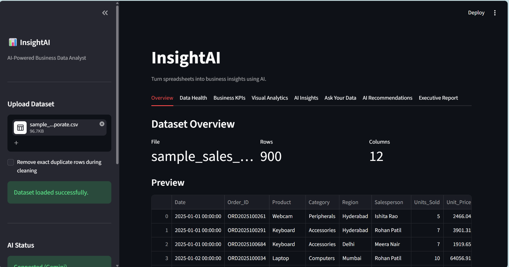
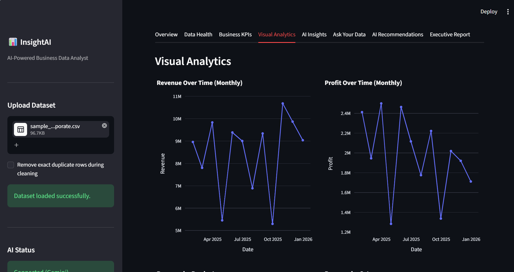
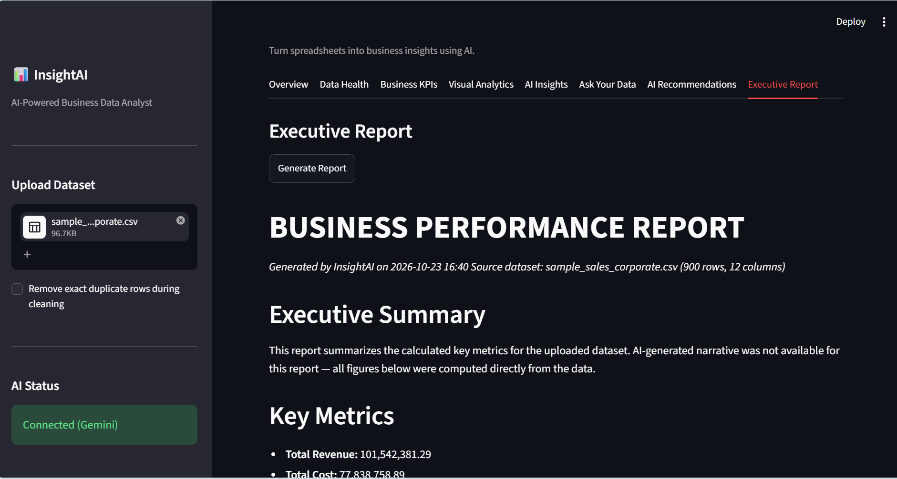
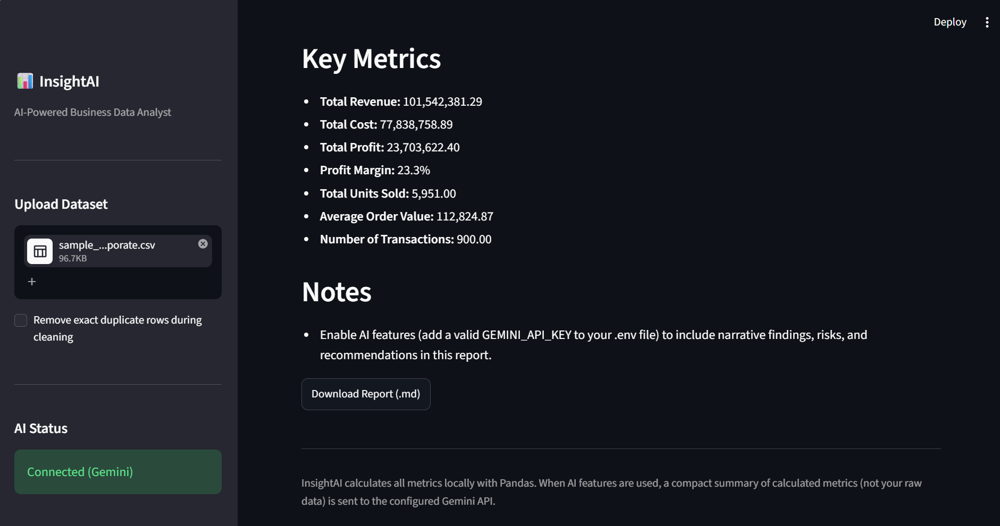

# InsightAI

**AI-Powered Business Data Analyst**

InsightAI is a Streamlit dashboard that turns a raw CSV or Excel export into
KPIs, charts, trend detection, and (optionally) AI-generated business
insights, an "Ask Your Data" chat, recommendations, and an executive report —
all runnable locally, for free.






---

## ✨ Features

- **Upload CSV or Excel** (`.csv`, `.xlsx`, `.xls`), with multi-sheet support
- **Automatic data cleaning** — empty rows/columns removed, whitespace
  trimmed, dates parsed — with a visible log of every change made
- **Automatic column type detection** — numeric, categorical, date, boolean,
  identifier — using dtypes plus lightweight name-based heuristics
- **Data Health dashboard** — missing values, duplicates, and a transparent,
  formula-based data quality score (not an AI guess)
- **Business KPIs** — revenue, cost, profit, margin, units, average order
  value — calculated only when the relevant columns actually exist
- **Visual Analytics** — trend lines, category breakdowns, distributions,
  and a correlation heatmap, generated dynamically with Plotly
- **Trend detection** — period-over-period % change, computed in Pandas, not
  guessed by an LLM
- **AI Insights, Ask Your Data, Recommendations, Executive Report** — all
  powered by the **free tier of the Google Gemini API**, and all strictly
  grounded in a compact, pre-calculated summary of your data (never raw rows)
- **Works fully without AI** — every core analytics feature works with zero
  API key configured; AI features simply say so and stay disabled

---

## 🧠 Design Philosophy: Python calculates, AI explains

Every number you see — totals, averages, percentages, growth, margins — is
computed with **Pandas**, never by prompting an LLM to do arithmetic. Gemini
is only used for interpretation, summarization, and natural-language answers,
and every AI prompt is explicitly told to use only the facts it's given, never
invent numbers, and never claim causation from correlation.

---

## 🏗️ Architecture

```
CSV / Excel
   ↓
Streamlit Upload
   ↓
Pandas (load → clean → profile)
   ↓
Analytics Engine (KPIs, trends, correlations)
   ↓
   ├──→ Charts (Plotly)
   ├──→ Data Health
   └──→ Structured Dataset Summary
           ↓
        Gemini API (free tier)
           ↓
   ├── AI Insights
   ├── Ask Your Data
   ├── Recommendations
   └── Executive Report
```

---

## 🧰 Tech Stack

| Layer | Choice |
|---|---|
| UI | Streamlit |
| Data processing | Pandas, NumPy |
| Visualization | Plotly |
| Excel I/O | OpenPyXL |
| AI | Google Gemini API (free tier) via `google-genai` |
| Config | python-dotenv |

No React, no backend framework, no database, no Docker — Version 1 is
intentionally simple so it's easy to run, read, and demo.

---

## 🚀 Installation (Windows)

```bash
cd insight-ai

python -m venv venv

venv\Scripts\activate

pip install -r requirements.txt

copy .env.example .env
```

```

Get a free key (no credit card required) from
[Google AI Studio](https://aistudio.google.com/app/apikey).

> **You can skip this step entirely.** InsightAI runs fully without a key —
> only the AI-powered tabs (AI Insights, Ask Your Data, Recommendations,
> AI report narrative) will show "AI features are currently unavailable.
> Core analytics are still available."

### macOS / Linux

```bash
cd insight-ai
python3 -m venv venv
source venv/bin/activate
pip install -r requirements.txt
cp .env.example .env
```

---

## ▶️ Running the app

```bash
streamlit run app.py
```

Streamlit will open automatically at:

```
http://localhost:8501
```

---

## 📄 Example dataset

A realistic, synthetic sales dataset is included at `data/sample_sales.csv`
(1,200 rows). It was generated with `generate_sample_data.py` using a fixed
random seed, so it's fully reproducible:

```bash
python generate_sample_data.py
```

The sample data has intentional patterns for the analytics engine to surface:
a strong-performing region, a regional revenue decline in a specific
quarter, rising demand for one product, and a slowly shrinking margin on
another.

Columns: `Date, Order_ID, Product, Category, Region, Salesperson,
Units_Sold, Unit_Price, Revenue, Cost, Profit, Customer_Type`

---

## 💬 Example questions to try in "Ask Your Data"

- "Which product performed best?"
- "Which region performed worst?"
- "Where are we losing money?"
- "Compare Mumbai and Pune."
- "What changed recently?"
- "What should management focus on?"

---

## 📁 Project Structure

```
insight-ai/
├── app.py                     # Streamlit UI and orchestration
├── generate_sample_data.py    # Reproducible synthetic dataset generator
├── requirements.txt
├── README.md
├── .gitignore
├── .env.example
│
├── data/
│   └── sample_sales.csv
│
├── modules/
│   ├── data_loader.py         # CSV/Excel ingestion, error handling
│   ├── data_cleaner.py        # Safe automatic cleaning
│   ├── data_profiler.py       # Column type detection + data health
│   ├── analytics.py           # KPIs, trends, correlations (pure Pandas)
│   ├── charts.py              # Dynamic Plotly chart generation
│   ├── ai_service.py          # Centralized Gemini API wrapper
│   ├── ai_insights.py         # Dataset summary + AI Insights
│   ├── ai_chat.py             # Ask Your Data
│   ├── recommendations.py     # AI Recommendations
│   └── report_generator.py    # Executive Report
│
├── utils/
│   ├── helpers.py              # Formatting / math helpers
│   └── constants.py            # Shared config, keyword hints, prompts
│
├── tests/
│   └── test_core.py            # Lightweight tests for pure-Python logic
│
└── screenshots/
```

---

## 🔒 Security & Privacy

- API keys are never hard-coded — configured only via `.env` (excluded from
  version control by `.gitignore`).
- When AI features are used, a **compact summary of calculated metrics**
  (totals, top categories, % changes) is sent to the configured Gemini API —
  **not** your raw row-level data.
- If you use the AI features, be aware that a summarized form of your data
  leaves your machine and is processed by Google's Gemini API under
  [Google's terms](https://ai.google.dev/gemini-api/terms). InsightAI does
  not claim your data stays fully private when AI features are enabled.
- No uploaded dataset is stored anywhere outside your local session.

---

## ⚠️ Known Limitations

- Trend detection compares only the two most recent periods (no
  forecasting).
- Column-role detection (which column is "revenue", "region", etc.) uses
  name-based heuristics; unusually named columns may not be auto-detected.
- The free Gemini tier has request-rate limits; heavy use of AI features may
  occasionally hit them (the app degrades gracefully when this happens).
- Report export is Markdown (.md) only in Version 1 — no PDF export yet.

---

## 🔮 Future Improvements

- Time-series forecasting
- Anomaly detection
- Natural-language chart generation
- PDF report export
- Database / Google Sheets / Power BI connections
- Multi-dataset joins
- Role-based access for a multi-user deployment

---

## 🧪 Testing

Lightweight tests for the deterministic (non-AI) logic live in `tests/`:

```bash
python -m pytest tests/ -v
# or, without pytest installed:
python tests/test_core.py
```

---

## 👤 Author

Yash Shengale

